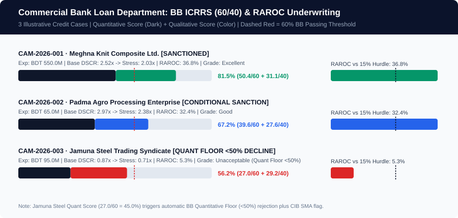
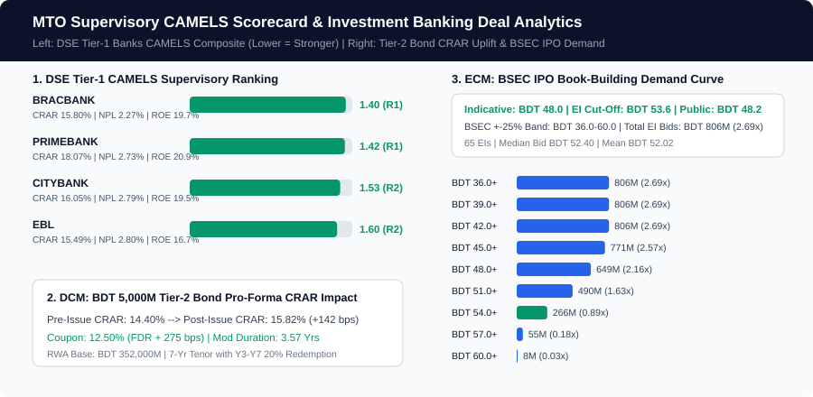

# Commercial Bank Credit Appraisal (`CAM` / `ICRRS`), `CAMELS` & Investment Banking Structuring Suite

**Abu Ishak** · B.Sc. (Honours) in Statistics, Jagannath University · Dhaka, Bangladesh  
[](https://www.linkedin.com/in/abuishak/)
[](mailto:a6uishak@gmail.com)
[](https://github.com/Abu-Ishak/commercial-credit-lending-ib-suite)
[](https://github.com/Abu-Ishak)

An institutional banking and corporate finance toolkit built for **Commercial Bank Credit / Loan Officer, Management Trainee Officer (MTO), Probationary Officer (PO), and Investment Banking (DCM/ECM)** workflows in Bangladesh.

- **Full 6-Page Executive PDF Deliverable:** [Commercial Credit CAM, CAMELS & IB Pitchbook Report (PDF)](./Commercial_Credit_CAM_CAMELS_and_IB_Pitchbook.pdf)
- **6-Sheet Loan Underwriting Workbook:** [`models/Commercial_Bank_Credit_Appraisal_CAM_ICRRS.xlsx`](./models/Commercial_Bank_Credit_Appraisal_CAM_ICRRS.xlsx)
- **4-Sheet CAMELS & IB Structuring Workbook:** [`models/IB_Bond_IPO_and_CAMELS_Suite.xlsx`](./models/IB_Bond_IPO_and_CAMELS_Suite.xlsx)
- **Institutional Memos:** [`Credit Appraisal Memorandum (CAM)`](./docs/Sample_Credit_Appraisal_Memorandum_CAM.md) · [`IB Tier-2 Bond & IPO Pitchbook`](./docs/IB_Tier2_Bond_and_IPO_Pitchbook_Memo.md)

---

## Module 1: Commercial Bank Loan Department & Credit Appraisal (`CAM` + BB `ICRRS`)

Implements Bangladesh Bank's **Internal Credit Risk Rating System (`ICRRS`)** (`60%` Quantitative / `40%` Qualitative + mandatory **`<50%` Quantitative Floor hard-stop override**), **`MPBF` (`75%`) Working Capital**, **Sight/B2B `LC -> PAD -> 90d LTR` Trade Finance**, **`DSCR` Stress Testing** (`-15%` EBITDA & `+200 bps` rate shock), **`BRPD` Loan Classification & Provisioning**, **`RAROC` pricing**, and **`CIB`/`KYC`/`CAD`** pre-disbursement controls *(3 illustrative borrower case studies)*:

| Case ID | Borrower | Exposure | Quant (`60%`) | Qual (`40%`) | ICRRS Grade | DSCR (`Base -> Stress`) | RAROC | Credit Decision |
| :--- | :--- | :---: | :---: | :---: | :--- | :---: | :---: | :--- |
| `CAM-2026-001` | **Meghna Knit Composite Ltd.** | `BDT 550.0M` | `50.4/60 (84.0%)` | `31.1/40` | `81.5% (Excellent)` | `2.52x -> 2.03x` | `36.8%` | **SANCTIONED** |
| `CAM-2026-002` | **Padma Agro Processing Enterprise** | `BDT 65.0M` | `39.6/60 (66.0%)` | `27.6/40` | `67.2% (Good)` | `2.97x -> 2.38x` | `32.4%` | **CONDITIONAL SANCTION** |
| `CAM-2026-003` | **Jamuna Steel Trading Syndicate** | `BDT 95.0M` | `27.0/60 (45.0%)` | `29.2/40` | `56.2% (Unacceptable (Quant Floor <50%))` | `0.87x -> 0.71x` | `5.3%` | **DECLINED (HARD STOP)** |

- **Working Capital (`MPBF`) & Trade Finance:** `Meghna Knit Composite` (`56d` Net Cash Cycle) generates `BDT 262.64M` `75% MPBF` ceiling (`CC Hypo` capped at `BDT 120.0M`); an illustrative `BDT 100M` `Sight LC` (`20%` margin) converts via `PAD` into `BDT 80.0M` `90-day LTR` maturing at `BDT 82.66M`.
- **BRPD Loan Classification & Provisioning:** Across an illustrative `BDT 10,000M` branch credit book (`3.50%` NPL), total required BRPD General + Specific Provision equals **`BDT 210.02M`** (`60.0%` coverage).



---

## Module 2: Bank `MTO` Supervisory Pack — DSE Tier-1 `CAMELS` Scorecard

Evaluates the four covered DSE Tier-1 banks across Bangladesh Bank's 6 `CAMELS` weights (`20% C + 25% A + 15% M + 20% E + 10% L + 10% S`, scale `1.00 Strong -> 5.00 Unsatisfactory`), anchored verbatim to the audited FY2025/2026 metrics in [`equity-research-portfolio`](https://github.com/Abu-Ishak/equity-research-portfolio):

| Ticker | Bank Name | CRAR | NPL | ROE | Cost/Income | ADR | Composite (`CAMELS`) |
| :--- | :--- | :---: | :---: | :---: | :---: | :---: | :---: |
| `BRACBANK` | BRAC Bank PLC | `15.80%` | `2.27%` | `19.70%` | `44.2%` | `81.4%` | **`1.40`** (`R1`) |
| `PRIMEBANK` | Prime Bank PLC | `18.07%` | `2.73%` | `20.85%` | `41.8%` | `79.8%` | **`1.42`** (`R1`) |
| `CITYBANK` | The City Bank PLC | `16.05%` | `2.79%` | `19.50%` | `46.5%` | `82.2%` | **`1.53`** (`R2`) |
| `EBL` | Eastern Bank PLC | `15.49%` | `2.80%` | `16.70%` | `39.6%` | `80.6%` | **`1.60`** (`R2`) |

---

## Module 3: Investment Banking Advisory (`DCM` Tier-2 Bond & `ECM` BSEC IPO Book-Building)

- **DCM — Basel III Subordinated Tier-2 Floating-Rate Bond (`BDT 5,000M`, `7-Year Tenor`, Illustrative):**
  - Floating coupon `6M FDR Benchmark (9.75%) + 275 bps = 12.50%` (`Floor 11.0% / Cap 14.5%`), `20%` annual redemption in Years 3–7, Modified Duration **`3.57 yrs`**, lifting pro-forma Basel III CRAR from **`14.40%` to `15.82%` (`+142 bps`)**.
- **ECM — BSEC IPO Book-Building Valuation (`Delta Precision Healthcare PLC`, `BDT 1,200M`, Illustrative):**
  - Blended Valuation (`40% FCFF DCF` + `35% EV/EBITDA` + `25% Peer P/E`) establishes **`BDT 48.0`** indicative price (`±25%` BSEC band: `BDT 36.0–60.0`). Simulating `65` `EI` bids (`2.69x` demand) clears Dutch auction at **Cut-Off `BDT 53.6`** and **Public Offer (`-10%`) `BDT 48.2`**.



---

## Repository Structure & Reproduction

```text
commercial-credit-lending-ib-suite/
├── README.md
├── requirements.txt
├── LICENSE
├── Commercial_Credit_CAM_CAMELS_and_IB_Pitchbook.pdf
├── src/
│   ├── credit_icrrs_engine.py
│   ├── camels_supervisory_scorecard.py
│   └── ib_bond_ipo_structuring.py
├── models/
│   ├── Commercial_Bank_Credit_Appraisal_CAM_ICRRS.xlsx
│   └── IB_Bond_IPO_and_CAMELS_Suite.xlsx
├── docs/
│   ├── Sample_Credit_Appraisal_Memorandum_CAM.md
│   └── IB_Tier2_Bond_and_IPO_Pitchbook_Memo.md
└── assets/
    ├── credit_icrrs_raroc_dashboard.svg
    └── camels_and_ib_deal_analytics.svg
```

```bash
pip install -r requirements.txt
python src/credit_icrrs_engine.py
python src/camels_supervisory_scorecard.py
python src/ib_bond_ipo_structuring.py
```

> *Disclaimer: Corporate borrower cases (`Meghna Knit`, `Padma Agro`, `Jamuna Steel`) and IB issuer structures (`Tier-2 Bond`, `Delta Precision Healthcare IPO`) are illustrative institutional demonstrations modeled on Bangladesh Bank (ICRRS, CIB, BRPD, Basel III) and BSEC regulations; DSE bank CAMELS indicators reflect public FY2025/2026 disclosures. Educational & recruitment portfolio only—not financial or credit advice.*
